# Fablecut

A studio for making videos with code, where every clip leaves reusable building blocks behind.

Graphics and animation are **assets**: parameterized JavaScript functions that draw a frame from
`(time, params)`. Assets call other assets (a scene calls a lower third, which calls a text reveal,
which calls an easing curve), live in a versioned SQLite library next to images, sounds and fonts,
and are composed into **clips**. The same asset code drives the live preview in the browser and the
final render, which goes frame by frame into FFmpeg and comes out as H.264/AAC MP4. An **MCP
server** lets Claude Code search the library, write and edit assets, compose clips, look at frames
and start renders. From inside the studio you **ask the agent**: a request goes into a queue,
Claude Code answers with a proposal, and you compare it with what is there and accept it.

## The showcase

Eleven clips, made in order through the MCP server. Each one grew the library and the next one reused it.

Clips 1 to 3, each 32 seconds:

| | clip | format | what it adds | what it reuses |
|---|---|---|---|---|
| [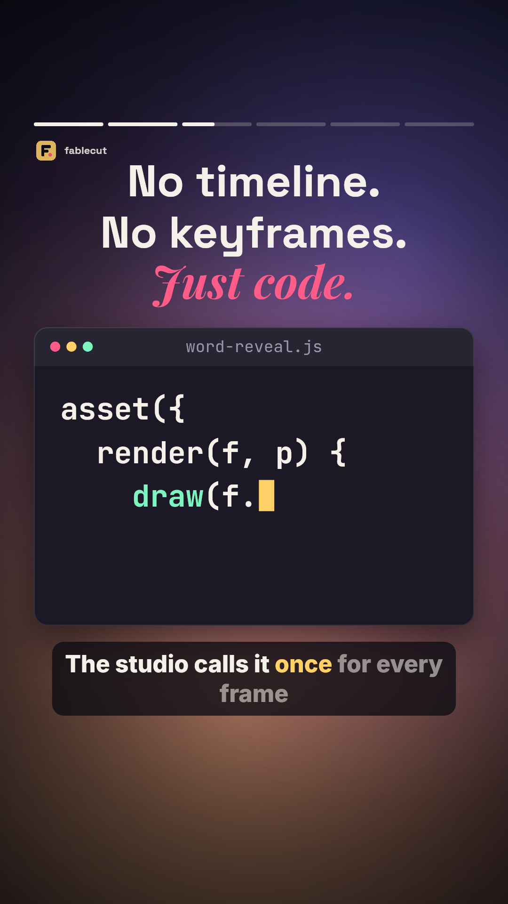](https://github.com/Narcis13/davidapp/releases/download/showcase-v1/clip-1-every-frame.mp4) | [**Every frame is a function**](https://github.com/Narcis13/davidapp/releases/download/showcase-v1/clip-1-every-frame.mp4) | vertical 1080×1920 | 28 assets: easing, spring, a theme, eight text animations, backgrounds, a code window, counters, a logo, a synthesized soundtrack | nothing: it is the first |
| [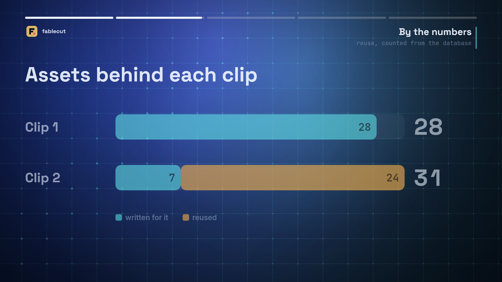](https://github.com/Narcis13/davidapp/releases/download/showcase-v1/clip-2-compounding.mp4) | [**The library compounds**](https://github.com/Narcis13/davidapp/releases/download/showcase-v1/clip-2-compounding.mp4) | horizontal 1920×1080 | 7 assets: a second theme, a grid, a scramble title, a lower third, a bar chart, a lineage diagram, a versioning diagram | 24 from clip 1, one of them (`text-word-reveal`) edited into version 2 |
| [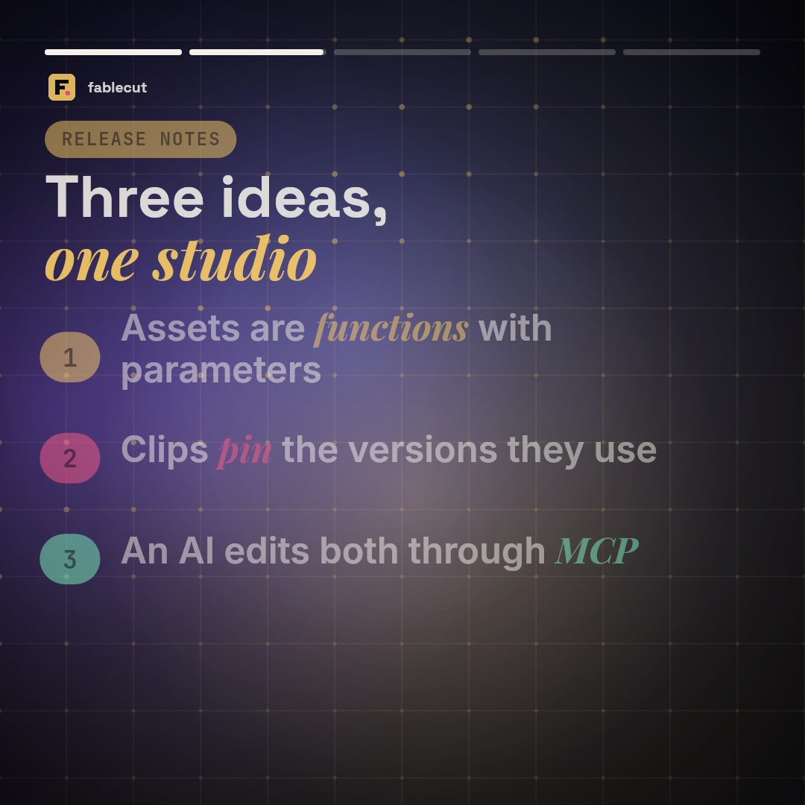](https://github.com/Narcis13/davidapp/releases/download/showcase-v1/clip-3-release-notes.mp4) | [**What's new in Fablecut**](https://github.com/Narcis13/davidapp/releases/download/showcase-v1/clip-3-release-notes.mp4) | square 1080×1080 | 5 assets: a bullet-list template, a badge, a formats diagram, and two forks of clip 1 assets (a confetti burst, a baked whoosh) | 24 from clip 1 and 5 from clip 2, as they are |

Clips 4 to 6 use what the second iteration added. They were built step by step through the MCP
server and the request flow (uploads, requests and accepted proposals on the user's side), and every
step was journalled, so `npm run showcase` replays them:

| | clip | format | what it adds | what it reuses |
|---|---|---|---|---|
| [](https://github.com/Narcis13/davidapp/releases/download/showcase-v2/clip-4-direct-the-studio.mp4) | [**Direct the studio**](https://github.com/Narcis13/davidapp/releases/download/showcase-v2/clip-4-direct-the-studio.mp4) | horizontal 1920×1080, 30 s; the same composition rendered [vertical](https://github.com/Narcis13/davidapp/releases/download/showcase-v2/clip-4-direct-the-studio-vertical.mp4) and [square](https://github.com/Narcis13/davidapp/releases/download/showcase-v2/clip-4-direct-the-studio-square.mp4) with per-format layouts | 14 assets: four motions, three transitions, four effects, an iris mask, a 3D orb, an SVG draw-on; a preset (`lower-third-studio`) and a precomp (`studio-title-card`) written by the studio; an uploaded photo and an uploaded SVG logo; one change made through a request | kinetic type, the stat scene, the logo sting, a background and the music from clip 1; the word reveal, the lower third and the theme from clip 2 |
| [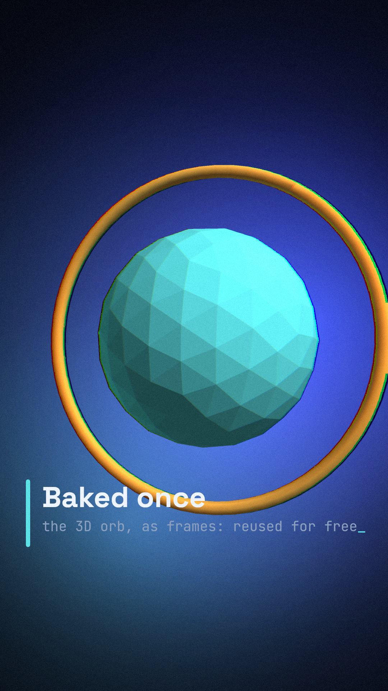](https://github.com/Narcis13/davidapp/releases/download/showcase-v2/clip-5-a-library-in-3d.mp4) | [**A library in 3D**](https://github.com/Narcis13/davidapp/releases/download/showcase-v2/clip-5-a-library-in-3d.mp4) | vertical 1080×1920, 60 s | 6 assets: a 3D terrain, 3D block text (and its version 2), a chromatic effect, a glitch transition, two motions; the orb baked into a frame sequence (`orb-spin`); an uploaded JPEG; a lower third added through a request | clip 4's motions, transitions, effects, title-card precomp and preset; text, stats, logo and music from clips 1 and 2 |
| [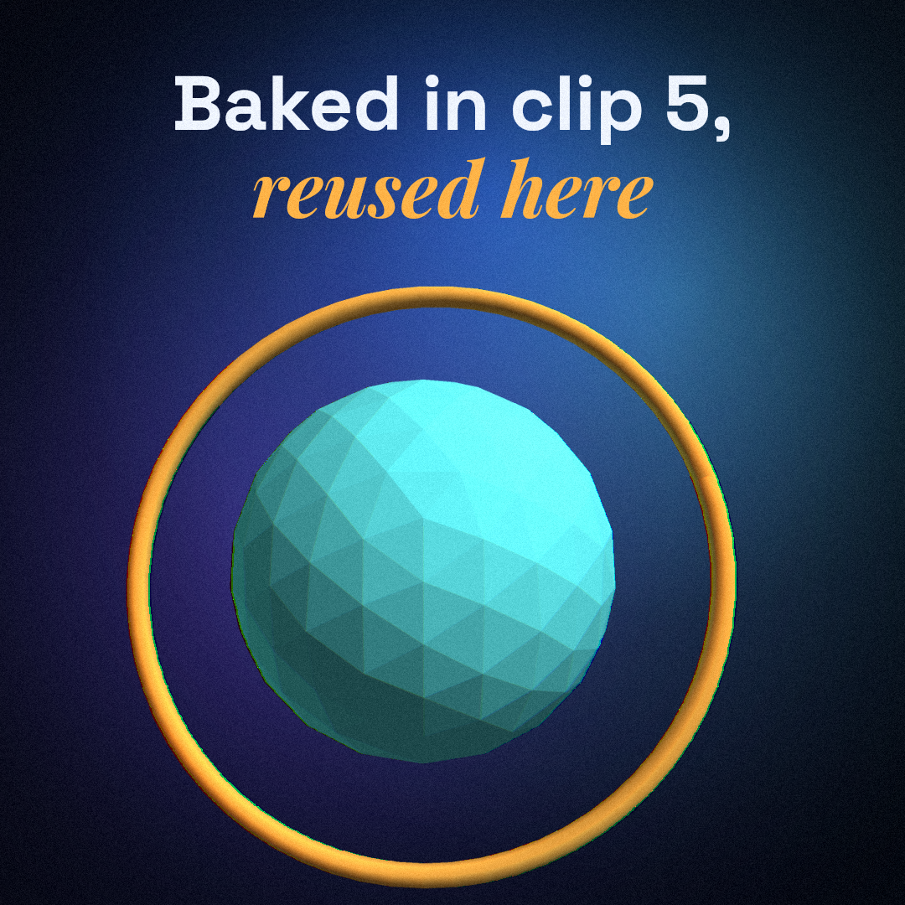](https://github.com/Narcis13/davidapp/releases/download/showcase-v2/clip-6-what-the-library-holds.mp4) | [**What the library holds**](https://github.com/Narcis13/davidapp/releases/download/showcase-v2/clip-6-what-the-library-holds.mp4) | square 1080×1080, 90 s | nothing: no new asset code | everything: the title card, 3D terrain and type, the baked orb, a bar chart, stats, text animations, transitions, effects, the uploaded photo, the music |

What each of them cost to build. The calls and the build time (first call to the render request)
come from the journals of the live build (`showcase/journal/*.jsonl`), which recorded every call
with its time; a rebuilt database replays the same calls in seconds, so it cannot give them. Lines
of code and reuse are read from the library. `scripts/reports-v2.mjs` writes the report:

| clip | length | MCP calls | new lines of asset code | timeline items reusing existing assets | build time |
|---|---|---|---|---|---|
| 4 · Direct the studio | 30 s | 40 | 242 | 60 % | 371 s |
| 5 · A library in 3D | 60 s | 20 | 123 | 64 % | 255 s |
| 6 · What the library holds | 90 s | 7 | 0 | 100 % | 76 s |

Clips 7 and 8 are finished videos, made through the gates of a motion process (brief, script, style frames,
transitions, animatic, final; the gate messages are in [work/](work/README.md)) and checked by the studio
itself: `check_clip` on every frame sampled, the mix measured, the encoded file measured.

| | clip | format | what it adds | what it reuses |
|---|---|---|---|---|
| [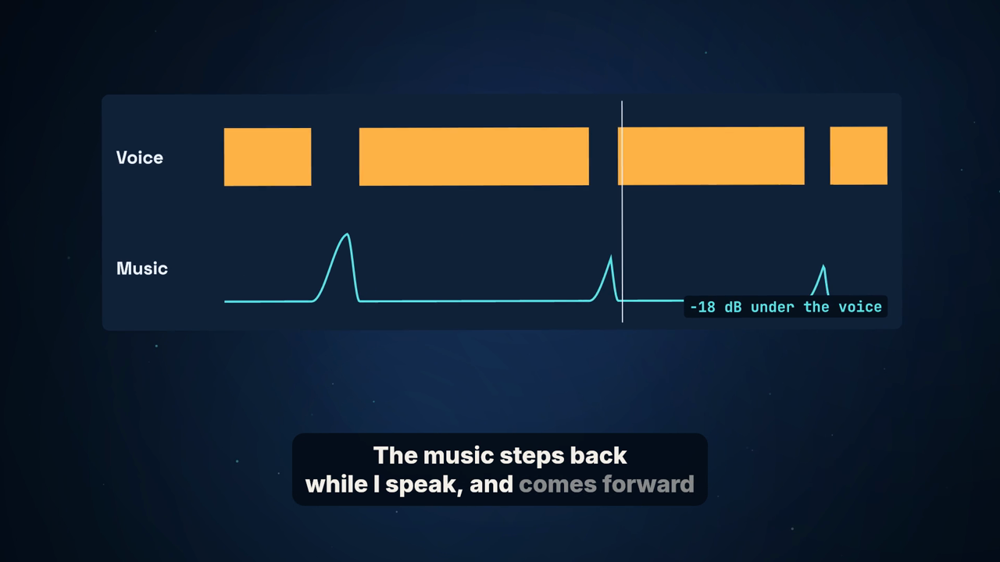](https://github.com/Narcis13/davidapp/releases/download/showcase-v3/clip-7-a-video-that-checks-itself.mp4) | [**A video that checks itself**](https://github.com/Narcis13/davidapp/releases/download/showcase-v3/clip-7-a-video-that-checks-itself.mp4) | horizontal 1920×1080, 62 s, voiced, captions burned in; the same composition [vertical](https://github.com/Narcis13/davidapp/releases/download/showcase-v3/clip-7-a-video-that-checks-itself-vertical.mp4) | a narration (Kokoro-82M, word times from whisper.cpp), 5 assets (title-plate, word-strip, duck-meter, check-list, end-card), text-captions v2; 31 visuals and markers anchored to their words | the background, particles, drift, music and theme from earlier clips |
| [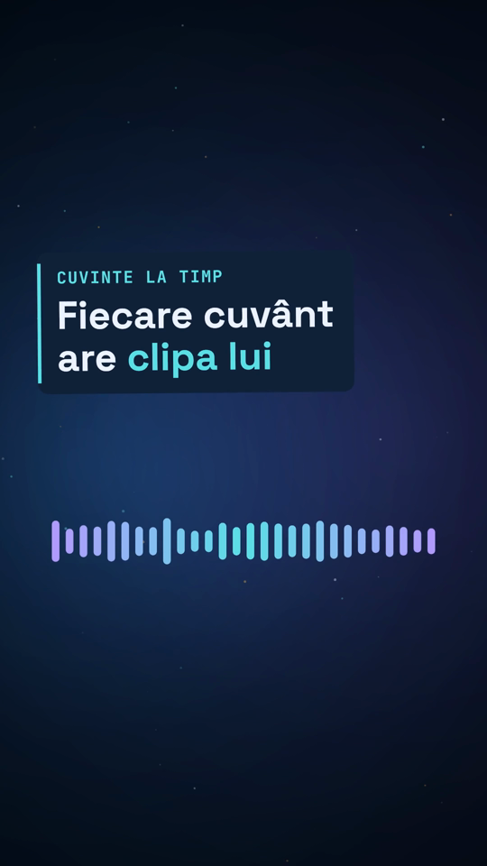](https://github.com/Narcis13/davidapp/releases/download/showcase-v3/clip-8-cuvinte-pe-ritm.mp4) | [**Cuvinte pe ritm**](https://github.com/Narcis13/davidapp/releases/download/showcase-v3/clip-8-cuvinte-pe-ritm.mp4) | vertical 1080×1920, 38.4 s, for Reels, in Romanian, cut on the music's bars | nothing: no new asset code | everything clip 7 made, the beat bars from clip 1 |

| clip | length | MCP calls | new lines of asset code | timeline items reusing existing assets | build time |
|---|---|---|---|---|---|
| 7 · A video that checks itself | 62 s | 49 | 908 | 20 % | 906 s |
| 8 · Cuvinte pe ritm | 38.4 s | 16 | 0 | 100 % | 151 s |

Both measure −14 LUFS (±0.2) with a true peak under −1 dBTP on the encoded file; in clip 7 the music sits
16.8 LU under the voice where it speaks. Evidence: [docs/showcase/v3](docs/showcase/v3/INDEX.md).

Clips 9 to 11 use what the fourth iteration added. Clips 9 and 10 went through the gates of the revised motion
prompt ([motion_prompt_fablecut.md](motion_prompt_fablecut.md)); clip 11 is a short tour so that every kit asset
appears in the showcase. Each was rendered with `final: true` and travels as `clips/<clip>/clip.json` plus the
store in `library/`; the working notes are in `work/<clip>/`.

| clip | format | what it adds | what it reuses |
|---|---|---|---|
| [**Your first clip**](https://github.com/Narcis13/davidapp/releases/download/showcase-v4/clip-9-your-first-clip.mp4) ([notes](work/clip-9-your-first-clip/05-final.md)) | horizontal 1920×1080, 54.6 s, voiced, captions burned in | five screen recordings of the studio (`scripts/record-studio.mjs`): find, tune, place, render; over them the kit's cursor (from each recording's sidecar), spotlight, camera, callouts and steps; a narration made in the studio (`generate_narration`); end-card@3 | the theme, text-captions@2, the title plate and the music from earlier clips |
| [**Every clip helps the next**](https://github.com/Narcis13/davidapp/releases/download/showcase-v4/clip-10-every-clip-helps.mp4) ([notes](work/clip-10-every-clip-helps/05-final.md)) | square 1080×1080 and [vertical 1080×1920](https://github.com/Narcis13/davidapp/releases/download/showcase-v4/clip-10-every-clip-helps-9x16.mp4) from one request, 27.5 s, voiced | a marketing video: the Fablecut logo as given (an SVG drawn as vectors), kit-ui-frame, kit-icon, kit-chart-line, kit-plate | clip 9's library recording and end card, the theme, captions and music |
| [**The kit**](https://github.com/Narcis13/davidapp/releases/download/showcase-v4/clip-11-the-kit.mp4) ([notes](work/clip-11-the-kit/README.md)) | horizontal 1920×1080, 16.1 s, music only | kit-ui-frame@2 (it scales in at its text floor), kit-chart-donut, and kit-arrow's first use | kit-steps, kit-plate, the library recording, the theme and music |

The MP4s are attached to the [`showcase-v1`](https://github.com/Narcis13/davidapp/releases/tag/showcase-v1),
[`showcase-v2`](https://github.com/Narcis13/davidapp/releases/tag/showcase-v2),
[`showcase-v3`](https://github.com/Narcis13/davidapp/releases/tag/showcase-v3) and
[`showcase-v4`](https://github.com/Narcis13/davidapp/releases/tag/showcase-v4) releases (videos
are never committed); `work/clip-9-your-first-clip/RENDER.md` and `work/clip-10-every-clip-helps/RENDER.md` say how to
render clips 9 and 10 from a clean checkout. Contact sheets, ffprobe reports, the reuse report and the verification
results are in [docs/showcase](docs/showcase/INDEX.md) for clips 1 to 3 and in
[docs/showcase/v2](docs/showcase/v2/INDEX.md) for clips 4 to 6, with the full
[compounding table](docs/showcase/v2/reports/compounding.md). Iteration 4's evidence (the clean rebuild with identical hashes, the checks, the compounding table with
clips 9 to 11, the round trips, the sweep, parity, speed) is indexed in [docs/showcase/v4](docs/showcase/v4/INDEX.md).

## Run it

Requirements: Node 24 and FFmpeg (on `PATH`, or set `FFMPEG_PATH`; on Windows the winget install
is found automatically).

```bash
npm install
npm run showcase      # builds the library and the eleven clips through the MCP server, and renders them
npm run sync-assets   # pushes every asset in assets/ into the library (new or changed ones only)
npm run studio        # the studio: http://127.0.0.1:8787
```

Everything is stored under `./data` (git-ignored): `studio.db`, asset thumbnails, uploaded files,
baked sequences, cached audio and `renders/`. `npm run seed` builds the library and clips without
rendering. Exports and evidence (`npm run evidence`, `npm run verify`) go to `./output` (also
git-ignored). No video is ever committed. The renders of clips 4 to 6 are large (180 to 600 MB
each: film grain does not compress), so leave a few gigabytes free for a full showcase build.

| variable | |
|---|---|
| `STUDIO_DATA` | The data directory (default `./data`). |
| `PORT`, `HOST` | Where the studio listens (default `127.0.0.1:8787`). |
| `STUDIO_AUTHOR` | Recorded as the author of what a process writes (the MCP server defaults to `mcp-client`, `.mcp.json` sets `claude-code`). |
| `STUDIO_TOOLS` | For an MCP server process: a comma-separated list of tool names; only these are registered. A "Run now" session's server gets the tools that read the studio and answer requests. |
| `STUDIO_RUNNER` | For an MCP server process: `0` means it does not pick up queued renders (a short-lived server would take a render down with it). |
| `FFMPEG_PATH` | FFmpeg, when it is not on `PATH`. |
| `STUDIO_RENDER_WORKERS` | Number of render worker threads (default: the CPU count minus two, at most 8). One render can ask for its own (`start_render { workers }`). |
| `STUDIO_FOOTAGE_CACHE_MB` | Memory for decoded footage frames, per process (default 512). |
| `STUDIO_REPO` | The repo `export_clip` writes to and `import_clip` reads from (default: this checkout). |
| `STUDIO_WHISPER_CLI`, `STUDIO_WHISPER_MODEL`, `STUDIO_WHISPER_MODEL_2`, `STUDIO_TTS`, `STUDIO_KOKORO_DIR`, `ELEVENLABS_API_KEY` | Voice and transcription; see [Voice and transcription](#voice-and-transcription). |
| `STUDIO_CLAUDE_BIN` | The `claude` CLI that "Run now" starts (default: `claude` on `PATH`; without one the button is hidden). |
| `STUDIO_AGENT_TIMEOUT` | Seconds a "Run now" session may take (default 600). |
| `CHROME` | The Chrome binary for the parity test and `scripts/parity.mjs`, `scripts/bench-library.mjs` (found automatically in the usual places; the parity test is skipped without one). |

Where things live:

```
assets/          every function asset's source, one flat folder (name.v2.js is version 2 of name)
clips/<name>/    one folder per clip: compose.mjs holds its composition; clip.json is its export (export_clip)
library/         the content store exported clips share: versions/, sources/, files/<sha256>
showcase/        build.mjs + plan.mjs: the MCP calls that rebuild clips 1 to 3;
                 journal/<clip>.jsonl: the recorded steps that rebuild clips 4 to 11; uploads/: their pictures, made by make.mjs;
                 footage/: the screen recordings and their sidecars; voice/: the committed narration takes
work/<clip>/     the gate notes, checks and sheets of the clips made through the motion prompt
fonts/           the bundled font files and their licences; vendor/lucide/: the icon set kit-icon draws
data/            the studio's runtime store: studio.db, thumbnails, files, caches, renders/  (git-ignored)
output/          exported renders, contact sheets and reports                                (git-ignored)
```

```bash
npm test              # asset contract and kinds, composition, 3D, uploads, requests, library at scale, render pipeline, HTTP API, MCP, preview/render parity
npm run verify        # version pinning and determinism, checked by frame hash through MCP
npm run report:reuse  # which clip created what, and what later clips reused
```

Scripts for building and measuring (usage is in each file's header; `STUDIO_DATA` selects the data directory):

```bash
node scripts/act.mjs <clip> <tool> '<json>'             # one MCP call as Claude Code, appended to showcase/journal/<clip>.jsonl
node scripts/act.mjs <clip> --user upload '<json>'      # what the user does in the studio: upload, create_request, accept, reject, reply
node scripts/hashes.mjs out.json [--compare base.json]  # frame hashes of clips 1 to 3; with --compare every hash must be identical
node scripts/speed.mjs out.json [--runs 3] [clip …]     # median render time of clips, through MCP
node scripts/parity.mjs [out-dir]                       # the same frames from the browser preview (headless Chrome) and from Node, with diff images
node scripts/evidence-v2.mjs [out-dir]                  # ffprobe checks, audio levels and contact sheets for the renders of clips 4 to 6
node scripts/reports-v2.mjs [out-dir]                   # the reports of iteration 2 from a showcase data dir and the journals: features, kinds, 3D, z-order, uploads, the clip request, compounding.md
node scripts/workflows-v2.mjs <base-url> [out-dir] [workflow …]      # the studio's workflows driven in headless Chrome with real input (scripts/lib/browser.mjs), each checked and written as a GIF; it changes the data, so run it on a copy
node scripts/speed-compare.mjs <baseline-checkout> <baseline-data> <data> [out-dir] [--runs 5]   # render speed against the code before the iteration, and what effects and 3D cost: render-speed.md
node scripts/synth-library.mjs <data-dir> [--count 5000]             # a seeded synthetic library of thousands of assets
node scripts/bench-library.mjs http://127.0.0.1:8787 [out.json]      # against a studio serving that library: search latency over HTTP, the library screen's DOM size while scrolling
node scripts/dev-seed-v2.mjs                            # development data with every new feature (test fixtures only)
node scripts/record-studio.mjs <url> <workflow> <out.mp4>            # a studio workflow recorded in headless Chrome: an MP4 and <out.mp4>.json (cursor, clicks, element boxes)
node scripts/library.mjs export <clip> | import <folder> [--verify]  # a clip to the repo and back (STUDIO_DATA or --data is required)
node scripts/roundtrip.mjs <clip>… [--clone]                         # export, import into an empty library, compare refs and frames
node scripts/prompt-tools.mjs [prompt.md]                            # every tool and option a prompt names must exist on the MCP server
```

## The studio

| | |
|---|---|
| **Library** `/` | Ranked search (text match, boosted by featured, favourites and use) with facets and their counts: type, kind, tags, format, author, the clip that made an asset, the clip that uses it. Sort by relevance, newest, most used or name; favourites, featured, collections, recently used, needs description. A virtualised grid with filmstrip previews, a detail panel, keyboard navigation, multi-select with bulk tagging and add-to-clip. Drop PNG, JPEG, WebP or SVG files on the page to upload them, video files (MP4, MOV, M4V, WebM, MKV) to add footage, and TTF, OTF or WOFF2 files to add fonts (a short form asks for the licence). The Licence button next to Upload sets the licence and source of the next drops; a file without one is recorded as "Licence unknown", and its card says a final render will refuse it. A "Kit" quick view lists the kit. |
| **Playground** `/assets/<name>` | Live preview of one asset of any kind with controls generated from its parameter schema, a scrub bar, format and safe-zone toggles. Keep a tweak: save the params as the new defaults (a new version) or as a preset, edit title, description and tags without a new version. A file asset has a "Source and licence" panel (edited without a new version) and shows placeholder and unknown-licence badges. The source in a CodeMirror editor (validate a draft, save a new version), version diffs (source, and the same frame side by side), versions, lineage. "Exact frame" asks the renderer for the same frame. The agent panel takes a request about this asset and shows the proposal next to the current version. |
| **Clips** `/clips` | Every clip as a card with a poster frame. |
| **Clip editor** `/clips/<name>` | Preview with audio and handles on the canvas: move, scale and rotate a layer, snapping to the frame, the safe zone and other layers. A format switch for per-format layouts. A timeline with move, trim, split, snapping, waveforms and keyframe marks; tracks you reorder, rename, lock, solo, mute and hide; a layers view. An inspector for timing, layout, keyframes with easing, parameters, motions, effects, transition and mask. Multi-select, copy, paste, duplicate, undo and redo (each action is one step; a drag or typing in one field counts as one), keyboard shortcuts (`?` lists them). A split leaves two parts that play on as one. "Save as asset" turns the selected layers into one library asset (a precomp) and can put it in their place. Footage items show a filmstrip of the frames they play and their edges trim the file (`in`, `out`). The caption pages are a lane under the narration: drag a page's start to another word, click a word to start a page there, select pages to merge them; the words and their times never change. Save, remix into another format, and the agent panel for requests about the clip. Render opens a panel: one or more shapes (one request), Normal, Draft (2/3 size, a quick look) or Final (the sources are checked and the credits written next to the video; a refusal names each asset that is not ready, with a link), workers, and the poster time from the playhead. The Credits panel lists the credit lines, the sources and what would stop a final render; the Repo panel says whether the clip's folder in the repo is up to date and writes it ("Write to repo"). |
| **Requests** `/requests` | The inbox of requests to the agent by status, and each request's thread with its proposals: preview, accept, reject with a reason, reply, "Run now". |
| **Renders** `/renders` | The queue with live progress, cancel, timings; drafts and finals labelled, a batch of shapes under one heading, a final's credits file linked. |
| **Gallery** `/gallery` | Finished clips with their poster, the MP4 and the assets each one used. |
| **Lineage** `/lineage` | Which clip produced which asset and which later clips reused it. |

Every screen updates live when the library, a clip, a render or a request changes, whichever
process made the change.

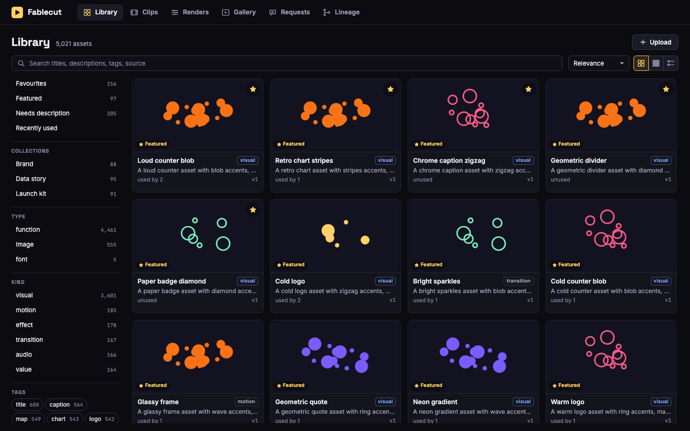
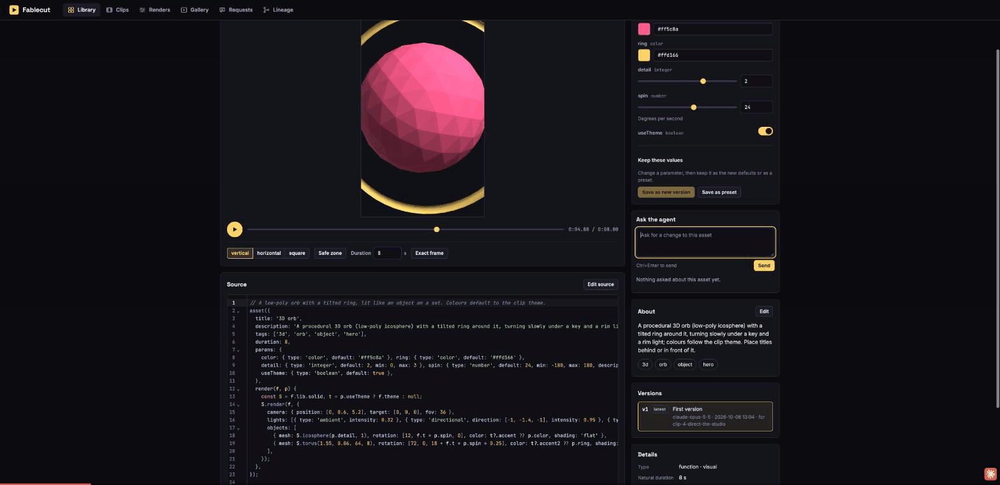
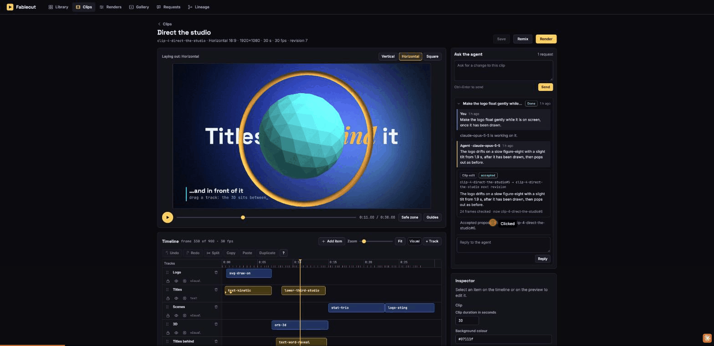
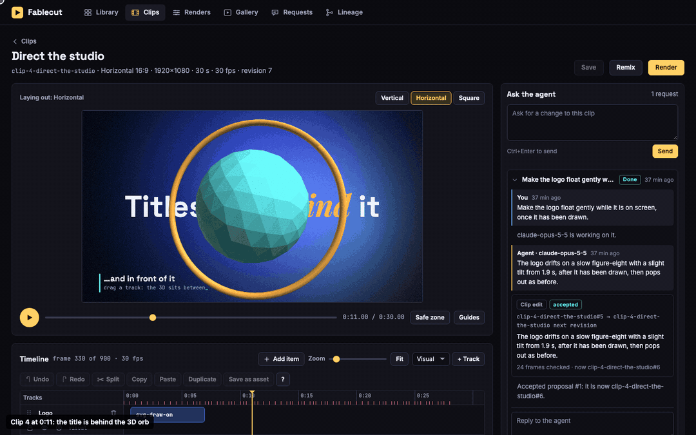
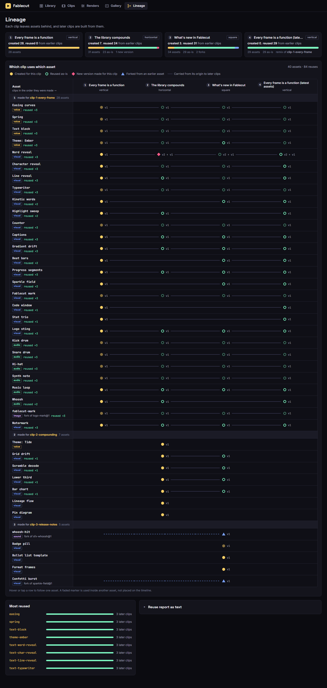
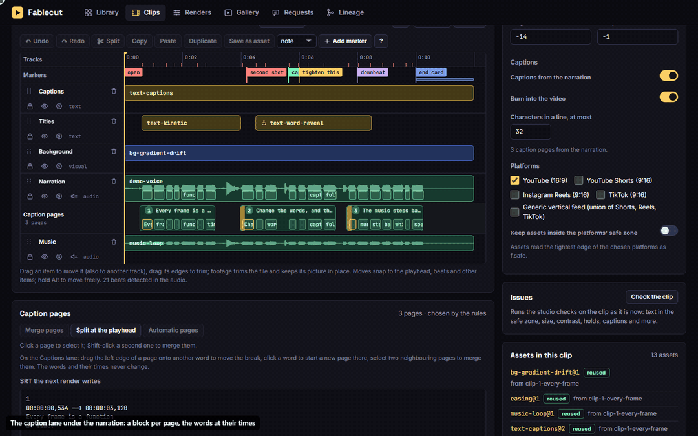
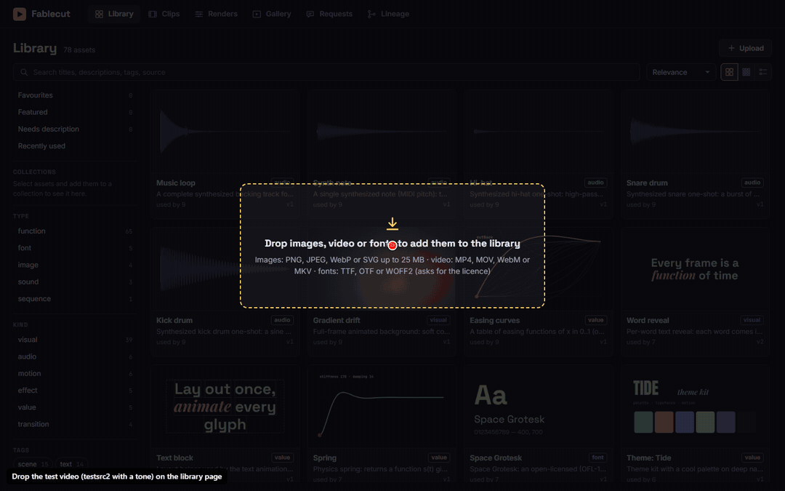
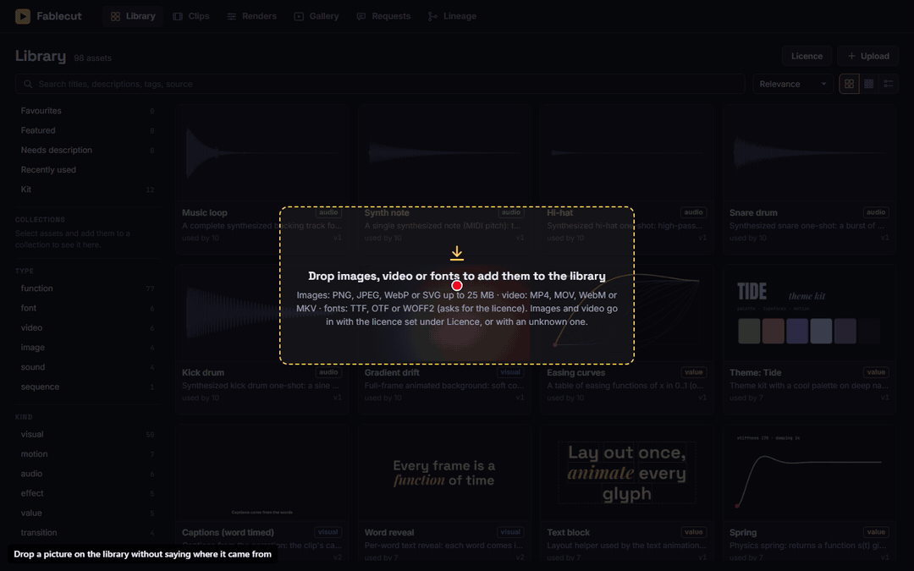
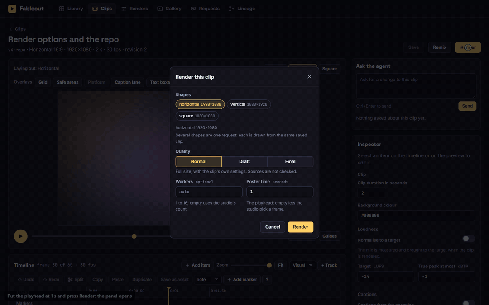

## Ask the agent

Write what you want in the agent panel of the playground or the clip editor, or on the Requests
screen: "make this slower", "add a lower third at 0:03", "a neon title for the library". The
request is a row in the database, scoped to an asset (with the params on screen), a clip (with the
selected items and the playhead) or the library.

Claude Code works the queue over MCP: `list_requests`, `claim_request` (the thread, the scope and
rendered frames), then `propose_asset_version`, `propose_new_asset` or `propose_clip_edit`. A
proposal is validated and drawn but changes nothing. It appears in the open page without a reload;
you preview it against the current version or clip and accept it (it becomes a new version, a new
asset or a clip revision), reject it, or reply to send the request back. If the asset moved on
since the proposal was made, accepting says so and offers to save it as the next version anyway;
a clip proposal is a list of edit operations, re-applied to the clip as it is when you accept.

```
open ── claim ──▶ working ── propose ──▶ review ── accept ──▶ done
  ▲                                         │
  └──── reply, or reject with a reason ◀────┘        (a claim lasts 15 minutes, then the request is open again)
```

"Run now" starts a headless `claude -p` session on one request from the web server. The session
gets only the studio's MCP server, and that server registers only the tools that read the studio
and answer requests (`STUDIO_TOOLS`) and takes no render jobs (`STUDIO_RUNNER=0`), so what the
session does still lands as a proposal. The prompt goes to the session on stdin, never on the
command line; on Windows an npm `claude.cmd` shim works as well as `claude.exe`. Its progress is
streamed into the thread; it has a timeout and can be cancelled. Without the CLI the queue works the same way from any Claude
Code session started in this folder.

## Write an asset

An asset is one source file that calls `asset({...})` once:

```js
asset({
  title: 'Word reveal',
  description: 'Words rise into place one after another. For headlines.',
  tags: ['text', 'text-animation', 'reveal'],
  duration: 4,                                  // natural length; omit for loops and backgrounds
  uses: ['easing'],                             // other assets it calls; pinned to a version on save
  params: {
    text:  { type: 'text', default: 'Every frame is a *function* of time' },
    size:  { type: 'number', default: 150, min: 12, max: 600 },
    color: { type: 'color', default: '#f4f1ea' },
  },
  render(f, p) {                                // a pure function of (f.t, p)
    const E = f.use('easing');
    const L = f.lib.text.layout(f.ctx, p.text, { font: 'Space Grotesk', weight: 700, size: p.size,
      maxWidth: f.safe.width, maxHeight: f.safe.height, fit: true, align: 'center', markup: true });
    const y = f.safe.y + (f.safe.height - L.height) / 2;
    for (const word of L.words) {
      const k = E.outExpo(f.lib.stagger(f.t, word.index, 0.08, 0.6));
      if (k <= 0) continue;
      f.ctx.globalAlpha = f.lib.clamp01(k * 2);
      f.ctx.fillStyle = p.color;
      f.lib.text.fillWord(f.ctx, word, f.safe.x, y + (1 - k) * 70);
    }
  },
});
```

- `render` may only depend on `f.t`, the params and `f.rng` (seeded). `Math.random()`, the clock,
  timers, modules and the network are rejected; so is anything that draws differently when the
  same frame is drawn twice.
- The parameter schema is what the studio builds controls from and what clips are validated against.
- `f.use('name', params, { x, y, width, height, at, duration })` draws another asset in a box and a
  time window; value assets (easing, themes) return a value instead; audio assets return samples.
- Saving validates the source in a sandbox, renders test frames in every format the asset supports,
  and stores it as an immutable version. Editing makes version 2; whatever pinned version 1 keeps it.

Six kinds, all written and versioned the same way:

| kind | what `render(f, p)` does | where it goes |
|---|---|---|
| `visual` | draws on `f.ctx` | an item on a track; a mask; inside another asset |
| `value` | returns a value (easing curves, a theme) | `f.use` from other assets; the clip's theme |
| `audio` | returns samples | an item on an audio track |
| `motion` | returns a transform delta for `f.phase` in, out, emphasis or loop | `item.motions[]` |
| `transition` | draws `f.from` turning into `f.to` over `f.progress` | `item.transition` |
| `effect` | draws a processed copy of `f.source`, with the pixel helpers in `f.lib.fx` | `item.effects[]`, `track.effects[]`, `composition.effects[]` |

Three more things an asset can do:

- **3D.** `f.lib.solid` is a software rasterizer in plain JavaScript: mesh generators (sphere, box,
  lathe, torus, extrusion, terrain, block text), a camera, lights, flat, smooth and toon shading,
  fog, a depth buffer. No WebGL, so the preview and the render draw the same bytes. Anything heavy
  can be baked once into a frame sequence (`bake_sequence`) and used as a layer.
- **Precomps and presets.** `f.layers(list, params)` draws clip-style layers inside an asset; the
  studio writes such an asset from the layers you pick in a clip ("Save as asset" in the clip
  editor, or `save_precomp`), transitions between them included. A preset is an
  asset plus a set of params as its defaults (`create_preset`).
- **Uploaded pictures.** `f.image(name)` gives an image; `f.svg(name)` gives the vector drawing of
  an uploaded SVG, to draw on stroke by stroke or recolour.

The full contract (the `f` object, the standard library, parameter types, every kind with an
example, transforms and keyframes) is in [docs/ASSET_CONTRACT.md](docs/ASSET_CONTRACT.md), and
recipes for the tools are in [docs/COOKBOOK.md](docs/COOKBOOK.md). Every asset source lives in
[assets/](assets); they are worked examples.

## Use it from Claude Code (MCP)

The repository registers the server in [.mcp.json](.mcp.json), so Claude Code started in this
folder gets a `studio` server with 67 tools:

| | |
|---|---|
| `studio_guide` | The asset contract, the cookbook, the workflows and what is in the library now. Start here. |
| `suggest_assets` | Give the brief of a clip or scene; get the library's best candidates, a few per kind, with params, notes and a contact sheet. The first call of every build. |
| `search_assets`, `get_asset` | Find assets by text, type, kind, tags, format, lineage, favourites, collections, with sorting and facet counts; read source, schema, versions, usage examples from real clips, notes. |
| `validate_asset` | Dry-run a draft: compile, check, and return a filmstrip. Nothing is saved. |
| `create_asset`, `update_asset`, `fork_asset` | Save a new asset, a new version, or a fork. The code is validated and test frames are rendered first; a broken asset is rejected with the reason. |
| `save_defaults`, `create_preset`, `save_precomp` | Keep a tweak: params as a new version's defaults, params as a named preset, clip layers as one asset. |
| `set_asset_metadata`, `organize_assets`, `add_asset_note`, `diff_versions` | Edit title, description, tags and a file's provenance without a new version; tag, favourite, feature or collect many assets; leave a note for the next agent; compare two versions (source and frame). |
| `upload_image`, `list_undescribed`, `describe_asset` | Add a PNG, JPEG, WebP or SVG; see the uploads that still need a description and write it (title, description, tags, suggested uses). |
| `add_file_asset`, `bake_asset`, `bake_sequence` | Add an image or sound file; bake one frame (or an audio asset) into a file asset; bake any visual asset into a frame sequence. All keep their lineage. |
| `add_footage`, `footage_frames` | Add a video file as footage; see its own frames, labelled with their time and index, to pick trim points. |
| `add_font`, `list_fonts` | Add a TTF, OTF or WOFF2 font with its licence (usable at once); list every family a font parameter can name. |
| `clip_credits`, `check_provenance` | A clip's credits and sources from everything it pins; what would stop a final render (placeholders, files with no licence). |
| `create_clip`, `update_clip`, `edit_clip`, `get_clip`, `list_clips` | Compose clips; references are pinned and params validated against each asset's schema. `edit_clip` has operations for the timeline, layers, transforms, keyframes and per-format overrides. |
| `remix_clip`, `repin_clip` | A clip in another format; a clip moved to newer asset versions. |
| `render_asset_frame`, `render_clip_frame` | One frame as PNG, or a contact sheet, so the model can see its work. |
| `frame_hashes` | SHA-256 of frames, for checking determinism and that old clips did not change. |
| `layout_report`, `check_clip` | Every text in a frame measured; what a careful editor would point at, with item, time, numbers and a still. |
| `add_narration`, `generate_narration`, `voice_samples`, `transcribe`, `speech_status`, `check_transcript` | A voice with its script and word times: imported, timed by the studio (`align`), or spoken from a script; one line in several voices; word times of any audio; what is set up; a take checked against its script. |
| `anchor_report`, `caption_pages`, `audio_report`, `export_stems` | How far anchored visuals are from their words; the caption pages and the rules they break; the mix measured; WAV stems. |
| `start_render`, `get_render`, `list_renders`, `cancel_render`, `render_report` | Render to MP4 (another format, several formats at once, a draft, a final render with credits) and follow the queue; what the studio measured on the encoded file. |
| `export_clip`, `import_clip` | A clip and everything it pins to `clips/<clip>/clip.json` and `library/` in the repo; that folder into any library, with the same refs and frames. |
| `list_requests`, `claim_request`, `get_request`, `reply_request`, `propose_asset_version`, `propose_new_asset`, `propose_clip_edit`, `complete_request` | Work the requests the user wrote in the studio and answer them with proposals. |
| `list_clip_assets`, `reuse_report`, `compounding_report` | What a clip uses and where each asset came from; what each clip cost to build. |

A typical session: *"Call studio_guide, then suggest_assets for a 15-second square clip announcing
our release. Reuse what exists. Show me a contact sheet before you render."* Or, with the studio
open: *"Work the studio's request queue."*

The same tools from a shell, over the same stdio protocol:

```bash
node scripts/mcp.mjs tools
node scripts/mcp.mjs call search_assets '{"tags":["text-animation"]}'
node scripts/mcp.mjs call render_clip_frame '{"clip":"clip-1-every-frame","t":13}' --out frame.png
```

Asset code runs only in worker threads, each asset in its own `vm` context without host globals,
and a watchdog stops a worker that overruns its time. That protects the studio from buggy assets;
it is not a sandbox for hostile code, so only connect clients you trust. The web server answers
only to loopback host names and refuses writes from other origins.

## Make a clip

A clip is a composition: format, frame rate, duration, and tracks of items that place an asset in
time with its parameters.

```js
{
  format: 'vertical', fps: 30, duration: 12, background: '#0b0b12',
  tracks: [
    { id: 'bg', type: 'visual', items: [{ id: 'bg', asset: 'bg-gradient-drift', start: 0, duration: 12 }] },
    { id: 'titles', type: 'text', items: [
      { id: 'hook', asset: 'text-kinetic', start: 0, duration: 4, params: { words: ['HELLO', 'WORLD'] } },
      { id: 'line', asset: 'text-word-reveal', start: 4, duration: 8, params: { text: 'Made with *code*' },
        box: { x: 0.07, y: 0.2, width: 0.86, height: 0.5 }, fadeOut: 0.4 },
    ] },
    { id: 'music', type: 'audio', items: [{ id: 'music', asset: 'music-loop', start: 0, duration: 12, gain: 0.8 }] },
  ],
}
```

Save it with `create_clip` / `update_clip` (or in the clip editor), look at it with
`render_clip_frame`, and render with `start_render` (or the Render button). Saving pins every
reference (`text-word-reveal` becomes `text-word-reveal@2`), so the clip renders the same frames
from then on, whatever happens to its assets. Tracks draw bottom to top; audio items are
synthesized by audio assets and mixed by FFmpeg; the beats found in the first audio item reach
every asset as `f.clip.beats`; an asset with a `cues` parameter is exported to SRT next to the MP4.

### Layout, keyframes and formats

An item can carry a free layout, animation and attachments. This one is from clip 4:

```js
{ id: 'title', asset: 'text-kinetic', start: 0.4, duration: 6.6, params: { words: ['DIRECT', 'THE', 'STUDIO'] },
  transform: { space: 'safe', x: 0.42, y: 0.5, width: 0.8, height: 0.75 },
  keyframes: { rotation: [{ t: 0, v: -5, ease: 'outBack' }, { t: 0.8, v: 0 }] },
  motions: [{ asset: 'motion-slide', phase: 'in', params: { from: 'left', distance: 0.2 } }],
  formats: { vertical: { transform: { x: 0.5, y: 0.42, width: 1, height: 0.5 } }, square: { transform: { x: 0.5, width: 0.95, height: 0.6 } } } }
```

- `transform` places the item's box: `x`, `y`, `width`, `height` are fractions of the frame (or of
  the safe zone with `space: 'safe'`), the anchor sits at (`x`, `y`), and `scale`, `scaleX`,
  `scaleY` and `rotation` (degrees) turn the box about it. The asset draws into the box, so it
  stays sharp at any scale.
- `keyframes` animate the transform fields, `opacity` and numeric or colour params
  (`params.<name>`), with easing curves taken from the library's `easing` asset.
- `formats` overrides the transform, keyframes, params, opacity or visibility for one format, so
  one composition is laid out for vertical, horizontal and square. `start_render { format }` renders
  it in another format; "remix" makes a separate clip.
- `motions`, `effects`, `transition` and `mask` attach assets of those kinds; effects also go on a
  track or on the whole clip. An image or a baked sequence can sit on a visual track directly
  (`params.fit`: `contain`, `cover`, `fill`). `composition.theme` names a theme asset that every
  asset reads as `f.theme`.
- An item without any of these fields is drawn by exactly the code that drew it before they
  existed, so clips 1 to 3 keep their pixels (`scripts/hashes.mjs` compares their frame hashes with a baseline).

The older `box` still works. A remix into another format re-flows what the assets draw (they lay
out from `f.width`, `f.height` and `f.safe`); per-format overrides are for what a hand-tuned
layout still needs.

## Uploads

Drop PNG, JPEG, WebP or SVG files on the library, or call `upload_image`. The type is read from
the bytes, a file already in the library (same SHA-256) is not added twice, and each upload gets
its size, a five-colour palette and a thumbnail. A file is at most 25 MB (a larger body is answered
with 413 and the reason), and an image whose header declares more than 16,384 pixels a side or 64
megapixels is refused before anything decodes it.

An SVG is rebuilt from an allowlist of drawing elements and attributes: scripts, event handlers,
`foreignObject`, embedded images, animation and external references are dropped and reported, and a
DOCTYPE or an entity declaration rejects the file. An internal `<style>` sheet is read, not dropped:
its simple rules (type, class and id selectors) are applied to the shapes as attributes and the sheet
goes; at-rules and anything that could fetch are left out and reported (`svg.dropped`). Linear and
radial gradients are kept, so a logo is drawn as it was given. Values are checked the same
way: a `url(...)` other than `url(#id)`, a CSS escape, and any function other than a colour (or a
transform function on a transform attribute) drops the attribute or style property. An SVG whose
`<use>` references multiply the drawing beyond a budget is refused. The sanitised SVG is stored
next to a PNG raster that both the preview and the render draw.

An upload waits on a needs-description list until the agent has looked at it:
`list_undescribed` returns the pictures, `describe_asset` writes the title, description, tags and
suggested uses, and from then on search finds it by those words.

## A library for thousands of assets

Search runs in SQLite: the FTS5 rank, weighted by field, is multiplied by what has proven useful
(featured, favourites, how many clips use it), and each facet is counted under the other filters. On a synthetic library of 5,021 assets the search API answers in 6.5 ms at the median and
80 ms at the 95th percentile, and the library screen keeps 400 to 570 DOM nodes while scrolling to
the last card ([measurements](docs/showcase/v2/reports/library-scale.json)). Make one with
`scripts/synth-library.mjs` and measure it with `scripts/bench-library.mjs`.

## The compounding loop

What makes the next clip cheaper than the last:

- `suggest_assets` ranks the library against a brief, so a build starts from what exists.
- Agents leave notes on assets (`add_asset_note`); `get_asset` shows them with real usage examples
  taken from the clips that use the asset.
- Presets and precomps turn a tuned set of params, or a group of layers, into one reusable piece
  without writing code.
- A clip theme (`composition.theme`, read as `f.theme`) makes new pieces match by default.
- Every MCP call is logged with the clip it served. `compounding_report` (and `/api/compounding`)
  gives, per clip, the calls, the new lines of asset code, the share of timeline items that reuse
  existing assets and the build time, for a clip built live in that database. A database rebuilt
  by `npm run showcase` replays the calls in seconds, so the table under "The showcase" takes its
  calls and build times from the journals of the live build (`scripts/reports-v2.mjs`).

## Finished videos, checked by the studio

What a voiced, captioned motion-graphics video needs, inside the studio (iteration 3):

- **Narrations.** A voice plus its script and the time of every word (`add_narration`), imported from what
  voice services and aligners return (word lists, ElevenLabs character alignment, whisper.cpp JSON) and aligned
  to the script, so word *i* is the same word in every take. Every asset reads the words as `f.clip.words`.
  A **transcript check** names slips, drops and insertions against the script (case, punctuation and numerals
  do not count; with two independent transcripts a word is wrong only when both say so).
- **Word anchors.** An item's start, a keyframe or a marker pinned to a word lands on it and stays there when the
  take changes (`anchor_report` gives the distance in frames).
- **Captions from the words.** Pages built by the rules (two lines, ~32 or 20 characters, phrase breaks, numbers
  with their units, names whole, on the first word or up to 2 frames early, at least 0.8 s), adjustable over MCP
  and in the composition; `text-captions@2` lights each word at its real time in the caption lane; every render
  writes SRT, WebVTT and the words as JSON; burned in or file only.
- **A real mix.** Gain automation in dB, ducking under the narration (from its words or its envelope), a loudness
  target reached with one gain (limiting the peaks first only when it must, and saying so), EBU R128 measured on
  every render, stems, and a report of how far the music sits under the voice, silences and clipping. The preview
  plays the same WAV the render encodes.
- **Text that cannot fail silently.** Size floors (a text that cannot fit at its floor is an error, never an
  ellipsis), a layout report of every text in frame pixels, glyph coverage from the fonts' own tables, Latin
  Extended in every bundled family, overlays (grid, title-safe, action-safe, platform zones, caption lane, text
  boxes) in the editor and in `render_clip_frame`, platform profiles (YouTube, Shorts, Reels, TikTok, a generic
  feed; sources in `src/core/platforms.js`; each applies only to the shapes it is made for) and **`check_clip`**: text outside its safe zone or cut by the frame,
  overlapping text, text in the caption lane, under its size floor, under 4.5:1 contrast against the worst pixels
  behind it, held too briefly, caption rule breaks, missing glyphs, an empty first frame, a last frame held under
  2 s, each with its item, time, numbers and a still. The editor lists them and jumps to each.
- **The render report**, from the encoded file: the MP4's facts, loudness, black frames, freezes (outside hold
  markers), brightness jumps (outside cut markers), flashing, silences, where the narration sits, and frame sheets
  with the times drawn in. Typed markers (cut, hold, beat, word, note) on the timeline feed the checks.
- **Inspection** in another format and from an unsaved draft (`render_clip_frame`, `frame_hashes`, sheets).
- **`sync-assets` never undoes a studio change**: it stops on a conflict and can `--pull` the library's version.

## Footage, fonts, voice, credits and the repo (iteration 4)

### Footage, and recordings of the studio

Video files are library assets (`add_footage`, or drop the file on the library): MP4, MOV, M4V, WebM or MKV,
kept as they are. A footage item is a layer like an image, trimmed with `in` and `out`, played at `speed`,
looped, or held on one frame (`hold`). It is frame-exact: every clip frame shows the last frame of the file at or
before its time, never a blend, and the preview and the render show the same one. At 1:1 on whole pixels the frame
is copied without smoothing, so a screen recording stays as sharp as it was recorded. The same ref on an audio
track plays the file's sound, and footage goes wherever an asset takes an image (the window of `kit-ui-frame`).
Each process runs one FFmpeg decoder per file and hands its frames to every render worker from a memory cache
(`STUDIO_FOOTAGE_CACHE_MB`, default 512).

`scripts/record-studio.mjs` records a studio workflow in headless Chrome with real input (a mouse that moves in
arcs, typed keys, drags) and writes an H.264 MP4 and a sidecar JSON with the cursor path, the clicks, the keys and
the boxes of the elements it touched, in the video's pixels. The kit's cursor, spotlight and camera take the
sidecar's numbers as they are. The workflows clip 9 was made from are in `scripts/recordings/` (each header says
what state it needs). A workflow changes the data, so point it at a studio on a scratch data dir
(`STUDIO_DATA=<scratch> PORT=8796 npm run studio`):

```bash
node scripts/record-studio.mjs http://127.0.0.1:8796/ library-search showcase/footage/library-search.mp4
```

A live capture is not deterministic; commit the MP4 and its sidecar (`showcase/footage/`) and every clip made from
them uses the same bytes.

### Fonts

`add_font` (or a font file dropped on the library) adds a TTF, OTF or WOFF2 with its licence. The family, weight
and style are read from the file, and its coverage (Unicode blocks, Latin Extended-A) is reported. It works at
once, in the preview and in renders, with no restart: name the family in any font parameter. A clip pins the font
files it was made with (`composition.fonts`), and `repin_clip` moves it to a new version. The five bundled
families in `fonts/` are font assets too; a save pins the ones its check saw drawn, so the credits list every font
a clip shows.

### Voice and transcription

The studio speaks a script and gives back the narration with every word's time, its transcript checked against
the script (`generate_narration`); times a recording you made (`add_narration { align: true }`); transcribes any
audio with word times (`transcribe`); and checks a take (`check_transcript { transcribe: true }`). No paid service
is needed: the voice is Kokoro-82M and the transcription whisper.cpp, both on this machine. A voice service
(ElevenLabs) is used only when its key is set. The settings come from the environment or a git-ignored `.env` at
the repo root, and `speech_status` says what is set up and what to set for each missing piece. Models are never
committed.

| variable | |
|---|---|
| `STUDIO_WHISPER_CLI` | whisper.cpp's `whisper-cli` (a release build), unless it is on `PATH`. |
| `STUDIO_WHISPER_MODEL` | A ggml model: `ggml-small.en.bin` for word times (`base.en` starts words up to 350 ms early). |
| `STUDIO_WHISPER_MODEL_2` | Optional, a second model (`ggml-base.en.bin`): the transcript check then calls a word wrong only when both models do. |
| `STUDIO_TTS` | `kokoro`, `elevenlabs` or `none`. Default: `kokoro` when `STUDIO_KOKORO_DIR` is set, else `elevenlabs` when its key is. |
| `STUDIO_KOKORO_DIR` | A folder that holds `tts/say.mjs`, with `kokoro-js` installed in `tts/node_modules`: `tools/voice` in this repo. |
| `ELEVENLABS_API_KEY` | The hosted voice; used only when set. |

`tools/voice/tts/say.mjs` is a short script around kokoro-js, kept out of the studio's own dependencies: install it
once with `npm ci --prefix tools/voice/tts` and set `STUDIO_KOKORO_DIR=tools/voice`. The model (about 90 MB) is
downloaded on first use into `tools/voice/cache/`, which git ignores. `node say.mjs --list` prints one voice a line
(`<id> <language> <gender> grade <grade>`), and `node say.mjs --voice <id> --speed <n> --out <file.wav>
--text-file <file.txt> --timings <file.json>` writes a 24 kHz mono WAV and where each sentence lies. whisper.cpp is
a separate download (a release build of `whisper-cli` and a ggml model from its Hugging Face page).

### Render options

`start_render` takes `draft: true` (an animatic at 2/3, 1/2 or 1/3 size, 1920×1080 becoming 1280×720, encoded
fast; the frames are drawn at full size first, so a draft's sampled frame hashes equal the full render's),
`formats: ["square", "vertical"]` (one render per shape from one request), `workers` (1 to 16 threads; the pixels
do not depend on it), `poster_at` (the poster frame's time) and `final: true` (below). `render_clip_frame` and
`frame_hashes` take `isolate: { only: [ids] }` or `{ except: [ids] }` to draw some items alone.

### Provenance, credits and final renders

Every file asset records where it came from: licence, licence and source URLs, creator, credit line, date,
whether it is AI-generated or registered with a content-ID system, restrictions, whether it is a placeholder and
whether it may be committed to a public repo. The tools that add files take these fields; what is left out is
recorded as unknown, never guessed, and `set_asset_metadata { provenance }` corrects it without a new version.
`clip_credits` builds a clip's credits from everything it pins, dependencies of dependencies included.
`start_render { final: true }` refuses a clip that holds a placeholder or a file with no licence, naming each and
what to do (`check_provenance` says the same without rendering), and writes `<render>.credits.md` next to the MP4.

### A clip in the repo, rebuilt anywhere

`export_clip` writes a finished clip to `clips/<clip>/clip.json` with everything it pins, at their version
numbers, into the shared store `library/` (`versions/`, `sources/`, `files/` by SHA-256), with the hashes of up to
48 frames. `import_clip` builds it in any library, an empty one included, with the same refs and the same frames.
Files that may not be redistributed (an unknown licence counts) or are over 50 MB stay out of git, listed by
SHA-256; an import looks for them in the folders it is given and names each one it cannot find. Clip 10 from a
clean checkout (`work/clip-10-every-clip-helps/RENDER.md`):

```bash
npm ci
export STUDIO_DATA=<an empty scratch dir>
node scripts/library.mjs import clips/clip-10-every-clip-helps --verify
node scripts/mcp.mjs call start_render '{"clip":"clip-10-every-clip-helps","formats":["square","vertical"],"final":true,"wait_seconds":900}'
```

`--verify` compares the frames with the hashes taken in the library the clip was made in; compare on the machine
that exported it (emoji and some fonts draw per operating system). `node scripts/library.mjs export <clip>` goes
the other way, and `scripts/roundtrip.mjs` checks the whole trip.

### The kit

Motion graphics for explainers, onboarding videos and marketing. The usage is at the top of each file in `assets/`
and in each asset's notes (`get_asset`).

| asset | |
|---|---|
| `kit-ui-frame` (version 2) | A browser window, a phone or a tablet around a picture or footage; at `scale: 1` a recording is drawn pixel for pixel. |
| `kit-cursor` | A pointer that follows a recording's cursor path and clicks, or makes a simple move. |
| `kit-spotlight`, `kit-camera` | Dim all but a region (a sidecar's element box works as it is); zoom and pan to it and back (a motion). |
| `kit-callout`, `kit-arrow` | A bubble pointing at a spot; a curved arrow that draws itself on. |
| `kit-steps`, `kit-plate` | Two to six steps, the current one moving on; the panel the others sit on, for contrast. |
| `kit-chart-line`, `kit-chart-donut` | Charts that draw on, with their labels at a size floor. |
| `kit-icon` | Icons from Lucide (ISC, in `vendor/lucide`), traced on. |
| `end-card@3` | A logo (an uploaded SVG drawn as vectors), a title, a button and an address, then still. |

They share a convention: positions are in the picture's own pixels (`space`, default 1440×900, the recorder's
size), mapped into the item box the way footage is placed there (`fit`); sizes are a share of the frame's short
side; text has a size floor and fails loudly instead of shrinking.

## How it works

```
src/core      the asset runtime, shared by Node and the browser: contract, schema, text layout, composition,
              transforms and keyframes, and the standard library (fx, solid, svg among it)
src/render    Node host: vm sandbox, Skia canvas (@napi-rs/canvas), worker pool, FFmpeg pipeline, WAV, beats
src/studio    library (versioned assets, search), clips (pinned compositions, edit operations), render queue,
              lineage, requests and proposals, "Run now", uploads and the SVG sanitiser, events, compounding: all on SQLite
src/mcp       the MCP tools (iteration 4's in src/mcp/more/, one module per area) and the stdio server
src/server    HTTP API, server-sent events, media, static files
src/ui        the studio (vanilla JS, no build step); preview-worker.js runs src/core in a Web Worker
assets        every function asset's source (synced into the library by scripts/sync-assets.mjs)
clips         one folder per clip with its composition
showcase      the plan and the journals that rebuild the eleven showcase clips
library       the content store clips are exported to (src/studio/exchange.js)
```

- **Rendering.** Worker threads draw frames in parallel with Skia (every frame is a pure function
  of its number, so order does not matter); the main thread writes them in order to FFmpeg's stdin
  as raw RGBA; FFmpeg encodes libx264 `yuv420p` with `+faststart` and mixes the audio inputs into
  AAC. Clips 1 to 3 (32 seconds, 2D, 1080p) render in about 4 to 8 seconds each on an i9 with 32
  logical CPUs (8 render workers) and in 13 to 24 seconds on an Apple M2 (6 workers), within 1 % of
  the code before the second iteration on both; pixel effects and 3D make clips 4 to 6 slower than
  realtime (clip 6, 90 seconds, renders in 2.5 minutes on the i9 and 4 on the M2). The numbers are in
  [render-speed.md](docs/showcase/v2/reports/render-speed.md) (i9) and
  [render-speed-macos-m2.md](docs/showcase/v2/reports/render-speed-macos-m2.md)
  ([iteration 1's](docs/showcase/reports/render-speed.md)).
- **One source of truth.** The preview does not re-implement anything: the browser loads the same
  `src/core` modules and the same asset source, and draws on an `OffscreenCanvas` in a worker.
  Effects and 3D are plain arithmetic on pixels rather than canvas filters or WebGL, because those
  differ between Chrome and Skia. `scripts/parity.mjs` draws the same frames both ways and compares them.
- **Library.** `node:sqlite` with FTS5. Asset versions are immutable (triggers enforce it); each
  version stores its source, schema, pinned dependencies, thumbnail, filmstrip, author and lineage.
  Clips store their pinned closure, so usage and reuse are queries. Edits to title, description and
  tags are an overlay on the asset, not a version.
- **Queue.** Renders are rows; the web server and the MCP server share the queue and either can
  run it. Every render keeps the composition it was made from, its FFmpeg log, ffprobe facts and
  SHA-256 hashes of sampled frames.
- **Live updates.** Every change writes a row to an `events` table in the same database, whichever
  process made it. The web server tails the table and pushes server-sent events (`/api/events`);
  the MCP server and the web server never talk to each other.
- **Dependencies.** `@napi-rs/canvas` (Skia), `@modelcontextprotocol/sdk` and `zod` (the MCP
  server), `acorn` (finds the `default:` values to rewrite when params are saved as defaults) and
  `codemirror` with `@codemirror/lang-javascript` (the code editor, served from `node_modules`
  through an import map: no build step, no CDN).

## Licenses

Fonts are bundled under the SIL Open Font License 1.1 (Inter, Space Grotesk, JetBrains Mono, Anton,
Playfair Display); their licenses are in [fonts/licenses](fonts/licenses). All showcase graphics
are drawn by code in this repository and all audio is synthesized by its audio assets; the
pictures uploaded in clips 4 and 5 are made by [showcase/uploads/make.mjs](showcase/uploads/make.mjs)
and the SVG logo is handwritten. Emoji fall back to the operating system's emoji font.

Clip 7's narration was generated locally with [Kokoro-82M](https://huggingface.co/hexgrad/Kokoro-82M)
(voice `af_heart`, Apache-2.0, through kokoro-js, Apache-2.0) and timed with whisper.cpp (MIT, Whisper weights
MIT); the voice file and its word timings are in [showcase/voice](showcase/voice) and the licences in
[docs/showcase/v3/LICENSES.md](docs/showcase/v3/LICENSES.md). The models are not in the repository.

The narrations of clips 9 and 10 were made the same way, inside the studio (`generate_narration`, voice
`af_heart`); their takes are in [showcase/voice](showcase/voice). The screen recordings in
[showcase/footage](showcase/footage) are of this studio, made by `scripts/record-studio.mjs`. `kit-icon` draws icons
from [Lucide](https://lucide.dev) (ISC licence; the licence and version are in [vendor/lucide](vendor/lucide)).
A final render lists every source of its clip in `<render>.credits.md`.
